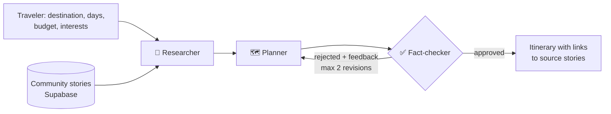
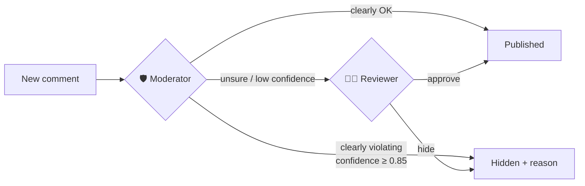

# ✈ Travel Journal with AI Agents

**Assignment:** AI Agents and Development Loops
**Live demo:** https://YOUR-APP.vercel.app  ← *(replace after deploying)*
**Login for grading:** email `(given separately)` / password `(given separately)`

Travel Journal is a full-stack community where travelers share trip stories with photos, discover trips from other people and talk about them in comment threads.
On top of it run **two teams of AI agents (5 agents in total)** that solve two real business challenges for a content community:

| Agent team | Mode | Business challenge |
|---|---|---|
| ✨ **AI Trip Planner**: Researcher → Planner ⇄ Fact-checker | Delivers on demand | Turn free user-generated content into a product that keeps visitors on the site and sends traffic to writers |
| 🛡️ **Comment Moderation**: Moderator → Reviewer | Runs **continuously** on every new comment | Keep the community safe without paying human moderators to read every comment |

---

## 1. The business challenges

### A. User content has value, but visitors don't use it
A travel community gets most of its visits from people **planning** a trip. They have to read many stories to piece together a plan, so most leave for Google, booking sites or AI chatbots, and the content creators get no traffic.

**The AI Trip Planner** reads the community's real stories and turns them into a day-by-day itinerary in under a minute. **Every idea links back to the story it came from.** That means:
- more page views and time on site (the core metric for an ad- or affiliate-funded travel site)
- traffic and recognition for the writers, which motivates them to post more
- a clear call to action when a destination isn't covered yet ("Been there? Share your trip"), which creates new content
- a trustworthy plan: generic AI chatbots invent things, but here a **Fact-checker agent rejects any idea not backed by a real story**

### B. Moderation is expensive, and toxic comments kill communities
Spam, scams ("DM me for cheap flights"), harassment and leaked personal data drive users away. Human moderation costs time on every single comment.

**The Moderation team** checks every comment automatically **before it is published**:
- clear cases are decided instantly by the Moderator
- borderline cases (low confidence) are escalated to a Reviewer agent, so rude but legitimate criticism isn't censored
- hidden comments stay visible to their author and the post owner, **with the reason** (transparency)
- the **AI moderation log** shows comments checked, hidden rate, escalations, categories and estimated moderator time saved

---

## 2. Agent architecture

### ✨ Trip Planner (with a development loop)



| Agent | Responsibility |
|---|---|
| 🔎 **Researcher** | Loads up to 25 stories from the database (destination first), selects the relevant ones and extracts concrete tips, each tied to its source story |
| 🗺️ **Planner** | Builds the day-by-day plan around the community tips. General suggestions are allowed but must be marked as not sourced |
| ✅ **Fact-checker** | Rejects a plan if a cited story doesn't support the idea, a source doesn't exist, the day count is wrong, or it ignores the budget or interests. Its feedback goes back to the Planner (max 2 revisions) |

Guardrails in code (not left to the AI): references to non-existent stories are removed or automatically rejected, and the number of days is checked deterministically.

### 🛡️ Comment moderation (continuous)



Categories: spam, scam, harassment, hate, personal data, disruptive off-topic. If the AI is unavailable, comments are approved and logged as *fallback*, so the site never breaks.

---

## 3. Where to find it in the app
- **✨ Trip Planner** in the header, or **"Plan a trip with AI"** on the home page (`/planner`)
- **🛡️ AI moderation log** in the avatar menu (`/moderation`)
- Try writing a spam comment like *"BUY CHEAP FLIGHTS NOW at cheap-deals.biz!!!"* on any post

---

## 4. Original features
- Create an account and log in or out with email and password
- Write trip posts with a title, a story, a country category and photos; edit or delete your own posts
- Browse the feed, search, and filter by country (`/category/spain`, …)
- Nested comment threads, likes, a My posts page, and a profile with avatar
- Responsive layout. Row Level Security keeps edits limited to the right user.

## 5. Tech stack
| Area | Technology |
|---|---|
| Framework | Next.js 16 (App Router, Server Components, Server Actions, streaming API route) |
| Language | TypeScript |
| AI agents | Groq API (free tier), model `openai/gpt-oss-120b` |
| Auth, database, storage | Supabase (Auth, PostgreSQL, Storage) |
| Styling | Tailwind CSS |
| Hosting | Vercel |

## 6. Project structure (AI parts)
```
lib/ai/
  llm.ts                    Groq helper (JSON output, retry on rate limits)
  types.ts                  Shared types
  planner-orchestrator.ts   Researcher → Planner ⇄ Fact-checker loop
  moderation.ts             Moderator → Reviewer escalation
  agents/                   researcher, planner, factchecker, moderator (+ reviewer)
app/api/planner/route.ts    Streams each agent's progress to the browser (NDJSON)
app/planner/                Trip Planner page
app/moderation/             AI moderation log + metrics
app/posts/actions.ts        addComment runs the moderation team before saving
supabase/ai-moderation.sql  Adds moderation columns to the comments table
```

## 7. Setup
1. `npm install`
2. Copy `.env.example` to `.env.local` and fill in the Supabase URL and anon key, plus a free `GROQ_API_KEY` from https://console.groq.com/keys
3. In Supabase → **SQL Editor**, run `supabase/ai-moderation.sql` once
4. `npm run dev` and open http://localhost:3000

On Vercel, add the same three environment variables.

## 8. Database overview
| Table | Purpose |
|---|---|
| auth.users | Accounts (Supabase Auth) |
| profiles | Name and avatar |
| categories | Countries used to group posts |
| posts | Trip posts: title, content, slug, author, category |
| post_images | Photos belonging to a post |
| comments | Comments, replies, **and the AI moderation decision** (status, category, reason, decided by) |
| post_likes | Which user liked which post |

## 9. Future improvements
- Vector search (embeddings) so the Researcher can use thousands of stories
- Let users save and share generated trip plans
- Moderate post text and images too, not only comments
- An admin view where humans can overturn moderation decisions (and use them as examples for the agents)
